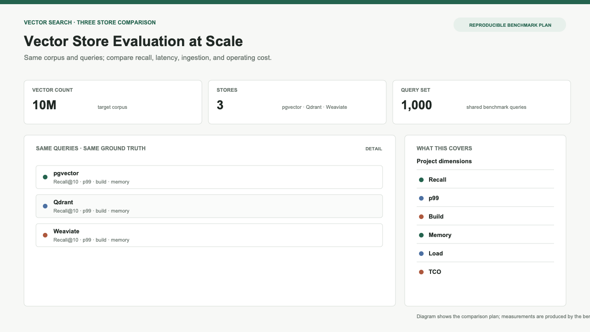
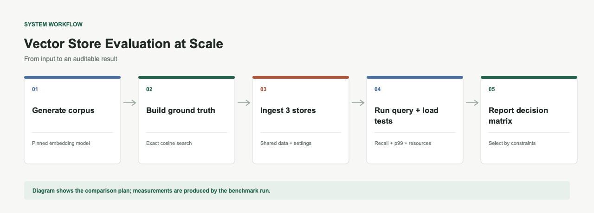

# Vector Store Evaluation at Scale

**pgvector, Qdrant, and Weaviate benchmarked at ten million vectors.**

Same corpus, same embedding model, same queries, three stores — run at a size where they stop looking alike. Recall against exact search, p99 under concurrent load, index build time, memory, and what it costs per month.

At a hundred thousand vectors they all look the same. Ten million is where the curves separate.





## Quick Start

```bash
pip install -e ".[dev]"
vsebench --help
```

### 1. Generate the corpus

```bash
vsebench generate --target 10000000 --output data/corpus
```

Downloads Wikipedia (or another HuggingFace dataset), embeds it with `all-MiniLM-L6-v2`, and writes 10M 384-dimensional vectors to Parquet. Also samples 1,000 query vectors for the benchmark.

### 2. Start the stores

```bash
docker compose -f docker/docker-compose.yml up -d
```

Brings up pgvector, Qdrant, and Weaviate with 32GB memory each.

### 3. Run the benchmark

```bash
vsebench run --corpus data/corpus --output results
```

Ingests the corpus into each store, runs the query suite, and computes recall against exact-search ground truth.

### 4. Generate the report

```bash
vsebench report --results results/summary_*.json --output results/report
```

Produces comparison tables, latency charts, recall charts, a cost model, and a decision matrix.

## What's measured

| Metric | Description |
|--------|-------------|
| Recall@10 | Fraction of exact-search top-10 results returned |
| p50 / p95 / p99 latency | Query latency percentiles in milliseconds |
| Index build time | Time to build the vector index after ingestion |
| Vectors/second | Ingestion throughput |
| Peak memory | Maximum memory during ingestion + indexing |
| Monthly cost | Estimated total cost of ownership at 10M vectors |

## Project structure

```
├── src/vsebench/
│   ├── cli.py                  # CLI entry point
│   ├── corpus/generator.py     # Dataset download and embedding
│   ├── ingestion/
│   │   ├── harness.py          # Abstract ingestion interface
│   │   ├── pgvector_store.py   # pgvector implementation
│   │   ├── qdrant_store.py     # Qdrant implementation
│   │   └── weaviate_store.py   # Weaviate implementation
│   ├── query/suite.py          # Query runner and recall computation
│   ├── benchmark/runner.py     # Orchestrates the full benchmark
│   ├── analysis/reporter.py    # Charts, tables, decision matrix
│   └── loadtest/locustfile.py  # Concurrent load testing
├── docker/                     # Docker Compose and Dockerfiles
├── terraform/                  # EKS cluster and store deployments
├── config/default.json         # Default configuration
├── tests/                      # Unit and integration tests
├── blog/                       # Blog post draft
├── Makefile                    # Convenience targets
└── README.md
```

## Infrastructure

### Local (Docker)

```bash
make docker-up          # Start pgvector, Qdrant, Weaviate
make docker-benchmark   # Run the benchmark container
make docker-monitoring  # Start Prometheus + Grafana
```

### Cloud (Terraform + EKS)

```bash
make terraform-init
make terraform-plan
make terraform-apply     # Creates EKS, deploys stores + monitoring
```

Provisions a 3-node EKS cluster with Helm charts for each vector store and a Prometheus/Grafana stack.

## Configuration

Edit `config/default.json` to adjust:

- Store connection strings
- Corpus generation parameters
- Benchmark settings (top-k, batch sizes, warmup)
- Cost model assumptions

## Decision Matrix

The report includes a decision matrix keyed to constraint profiles:

| Scenario | Constraint |
|----------|-----------|
| Low latency, high recall | p95 < 20ms, recall > 0.95 |
| Best recall at any cost | recall > 0.99 |
| Cheapest to operate | Cost-sensitive |
| Fastest ingestion | Ingestion priority |
| Filtered search required | Metadata filtering needed |

## Reproducibility

- Corpus generation is seeded (seed=42)
- Embedding model version is pinned in the manifest
- Query vectors are saved alongside the corpus
- Ground truth is computed once via exact cosine search and saved
- Docker images and Helm chart versions are pinned
- Infrastructure is defined in Terraform

Someone else can reproduce the full benchmark from the repo inside an hour.

## Blog post

See `blog/benchmark-post.md` for the companion technical write-up.

## License

MIT
